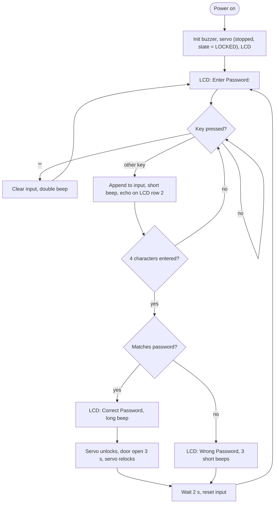
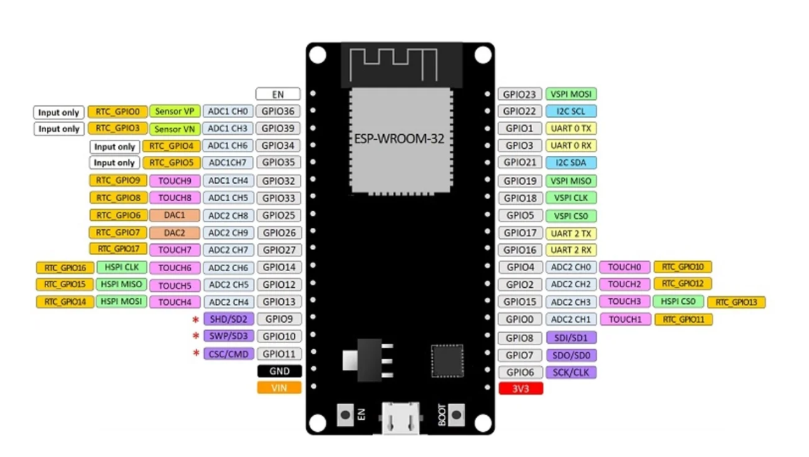
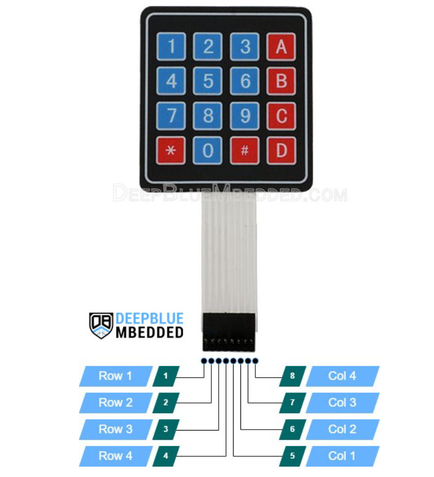
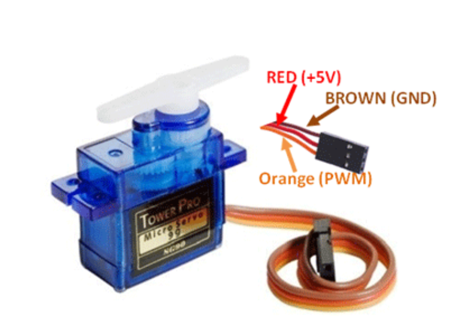

# GatePass

**An ESP32-based smart gate lock that opens with a keypad password.**


GatePass is an embedded IoT project built for a school assignment. A user types a 4-digit password on a 4×4 matrix keypad. The ESP32 checks it and, if it is correct, drives a continuous-rotation servo that pulls back a lock bolt, keeps the door unlocked for a few seconds, then locks it again. A 16×2 I²C LCD and a buzzer give the user feedback at every step.

---

## Table of Contents

- [Features](#features)
- [How It Works](#how-it-works)
- [Hardware](#hardware)
- [Wiring](#wiring)
- [Software Stack](#software-stack)
- [Project Structure](#project-structure)
- [Getting Started](#getting-started)
- [Configuration and Tuning](#configuration-and-tuning)
- [Usage](#usage)
- [Firmware Architecture](#firmware-architecture)
- [Serial Monitor Output](#serial-monitor-output)
- [Troubleshooting](#troubleshooting)
- [Known Limitations](#known-limitations)
- [Roadmap](#roadmap)
- [License](#license)
- [Author](#author)

---

## Features

- **Keypad authentication.** Password entry on a 4×4 matrix keypad (digits `0-9`, `A-D`, `#`, `*`).
- **Automatic locking.** The door unlocks, stays open for a configurable delay (3 s by default), then relocks without any user action.
- **LCD prompts.** A 16×2 I²C LCD shows `Enter Password:`, the characters typed so far, and the result (`Correct Password` / `Wrong Password`).
- **Audible feedback.** A buzzer gives a short beep per key press, a long beep on success, three short beeps on failure, and a double beep when the input is cleared.
- **Clear key.** Pressing `*` wipes the current input and resets the prompt.
- **Modular servo driver.** The lock mechanism lives in its own module (`servo.h` / `servo.cpp`) with a low-level API (`turn_left`, `turn_right`, `stop`) and a high-level API (`unlockDoor`, `lockDoor`).
- **Tunable mechanics.** Pulse widths, spin durations and door-open time are `#define` constants, so you can adapt the firmware to your own bolt travel.
- **Debug logging.** Every important event is printed over serial at 115200 baud.

---

## How It Works



---

## Hardware

| Component | Details | Qty |
|---|---|---|
| Microcontroller | ESP32 DevKit (ESP-WROOM-32, `esp32dev` board) | 1 |
| Keypad | 4×4 membrane matrix keypad (8-pin ribbon) | 1 |
| Display | 16×2 LCD with I²C backpack (PCF8574, address `0x27`) | 1 |
| Lock actuator | Continuous-rotation servo (5 V) | 1 |
| Buzzer | Active buzzer (driven with a plain HIGH/LOW signal) | 1 |
| Power | USB 5 V, or an external 5 V supply for the servo | 1 |
| Misc. | Breadboard and jumper wires | - |

> **Servo note:** the firmware controls speed and direction with `writeMicroseconds()`, so it needs a **continuous-rotation** servo, not a standard 0-180° positional one. The wire colors in `docs/servo.png` (red = +5 V, brown = GND, orange = PWM signal) are the standard color code for hobby servos such as the Tower Pro SG90.

---

## Wiring

### Pin map

| Peripheral | Signal | ESP32 GPIO |
|---|---|---|
| **Keypad** | Row 1 | `18` |
| | Row 2 | `19` |
| | Row 3 | `14` |
| | Row 4 | `27` |
| | Column 1 | `26` |
| | Column 2 | `25` |
| | Column 3 | `33` |
| | Column 4 | `32` |
| **LCD (I²C)** | SDA | `21` (ESP32 default) |
| | SCL | `22` (ESP32 default) |
| | VCC / GND | `VIN` (5 V) / `GND` |
| **Servo** | Signal (orange) | `12` |
| | VCC (red) | `VIN` (5 V) or external 5 V |
| | GND (brown) | `GND` |
| **Buzzer** | Signal (+) | `23` |
| | GND (-) | `GND` |

### Keypad ribbon order

The keypad ribbon connector has 8 pins: **pins 1-4 are Rows 1-4** and **pins 5-8 are Columns 1-4** (see `docs/keypad.png`).

### Reference diagrams

| ESP32 pinout | Keypad | Servo |
|:---:|:---:|:---:|
|  |  |  |

> **Power tip:** if the servo makes the ESP32 reset or the LCD flicker, power the servo from an external 5 V source and **connect its ground to the ESP32 ground**.

---

## Software Stack

| Layer | Technology |
|---|---|
| Build system | [PlatformIO](https://platformio.org/) |
| Platform / board | `espressif32` / `esp32dev` |
| Framework | Arduino |
| Language | C++ |
| Serial baud rate | 115200 |

### Libraries (declared in `platformio.ini`)

| Library | Version | Purpose |
|---|---|---|
| [`Chris--a/Keypad`](https://github.com/Chris--a/Keypad) | 3.1.1 | Matrix keypad scanning |
| [`madhephaestus/ESP32Servo`](https://github.com/madhephaestus/ESP32Servo) | 0.13.0 | Servo PWM on the ESP32 |
| [`marcoschwartz/LiquidCrystal_I2C`](https://github.com/marcoschwartz/LiquidCrystal_I2C) | latest | I²C LCD driver |
| [`blynkkk/Blynk`](https://github.com/blynkkk/blynk-library) | 1.3.2 | Declared as a dependency but **not used yet** (reserved for remote control) |

---

## Project Structure

```text
gatepass/
├── docs/
│   ├── esp32.png          # ESP32 DevKit pinout reference
│   ├── keypad.png         # 4x4 keypad pin mapping
│   └── servo.png          # Servo wire colors
├── include/
│   ├── README             # PlatformIO placeholder
│   └── servo.h            # Servo driver API, pins and tuning constants
├── lib/
│   └── README             # PlatformIO placeholder (private libraries)
├── src/
│   ├── main.cpp           # Keypad, LCD, buzzer and password logic
│   └── servo.cpp          # Continuous-servo lock/unlock implementation
├── test/
│   └── README             # PlatformIO placeholder (unit tests)
├── .gitignore
├── LICENSE.md
├── platformio.ini         # Board, framework, libraries, monitor speed
└── README.md
```

---

## Getting Started

### Prerequisites

- [PlatformIO](https://platformio.org/install) (VS Code extension or CLI)
- An ESP32 DevKit board and a USB data cable
- The hardware listed above, wired as described in [Wiring](#wiring)

### Installation

```bash
# 1. Clone the repository
git clone https://github.com/hatixntsoa/gatepass.git
cd gatepass

# 2. Build the firmware (libraries are downloaded automatically)
pio run

# 3. Upload to the ESP32 (with the board connected over USB)
pio run --target upload

# 4. Open the serial monitor
pio device monitor
```

If the upload hangs on `Connecting...`, hold the board's **BOOT** button until the upload starts.

---

## Configuration and Tuning

### Password

The password is defined in `src/main.cpp`:

```cpp
#define PASSWORD_LENGTH 4
const String PASSWORD = "1111";
```

Change `PASSWORD` to your own value. If you change its length, update `PASSWORD_LENGTH` too, since the check runs as soon as that many characters are entered.

### Pins

| What | Where | Default |
|---|---|---|
| Buzzer | `BUZZ_PIN` in `src/main.cpp` | `23` |
| Keypad rows / columns | `rowPins` / `colPins` in `src/main.cpp` | `{18,19,14,27}` / `{26,25,33,32}` |
| Servo signal | `SERVO_PIN` in `include/servo.h` | `12` |
| LCD address | `LiquidCrystal_I2C lcd(0x27, 16, 2)` in `src/main.cpp` | `0x27` (use `0x3F` for some backpacks) |

### Servo and lock mechanics (`include/servo.h`)

| Constant | Default | Meaning |
|---|---|---|
| `SERVO_FREQ_HZ` | `50` | Standard servo PWM frequency |
| `SERVO_STOP_US` | `1500` | Neutral pulse. Tune by ±10 µs if the servo creeps while "stopped" |
| `SERVO_CW_US` | `1800` | Slow clockwise pulse. The firmware uses it to **unlock** |
| `SERVO_CCW_US` | `1200` | Slow counter-clockwise pulse. The firmware uses it to **lock** |
| `SERVO_CW_FAST_US` / `SERVO_CCW_FAST_US` | `2000` / `1000` | Full-speed pulses (defined, not used by default) |
| `UNLOCK_DURATION_MS` | `300` | How long the servo spins to retract the bolt |
| `LOCK_DURATION_MS` | `300` | How long the servo spins to extend the bolt |
| `DOOR_OPEN_MS` | `3000` | How long the door stays unlocked before relocking |

Lock and unlock are **time-based**: the servo spins for a fixed duration and stops, with no position feedback. Adjust `UNLOCK_DURATION_MS` and `LOCK_DURATION_MS` until the bolt travels the right distance. If it moves the wrong way, swap the `turn_right` / `turn_left` calls in `src/servo.cpp` or swap the two pulse constants.

---

## Usage

| Action | Result |
|---|---|
| Power on | LCD shows `Enter Password:`; the system is considered **locked** |
| Press any key | Short beep; the character appears on the LCD's second row |
| Enter the correct 4 characters | `Correct Password`, long beep, servo unlocks the door, waits 3 s, then relocks |
| Enter a wrong 4 characters | `Wrong Password`, three short beeps |
| Press `*` | Input cleared, double beep, prompt reset |

After every attempt (success or failure) the screen returns to the prompt after 2 seconds.

---

## Firmware Architecture

### `src/main.cpp` (application layer)

- `setup()` initialises serial, the buzzer, the servo module and the LCD, then shows the prompt.
- `loop()` polls the keypad, handles the `*` clear key, appends characters to `inputPassword`, mirrors them on the LCD and calls `checkPassword()` once the input reaches `PASSWORD_LENGTH`.
- `checkPassword()` compares the input with `PASSWORD`, updates the LCD, triggers the matching buzzer pattern and calls `unlockDoor()` on success.
- `correctBuzz()` / `wrongBuzz()` produce the success and failure sounds.

### `src/servo.cpp` and `include/servo.h` (actuator layer)

| Function | Level | Description |
|---|---|---|
| `servoInit()` | Setup | Allocates the PWM timer, attaches the servo (500-2400 µs), stops it and marks the door locked |
| `stop()` | Low | Sends the neutral pulse so the servo stops |
| `turn_left(ms)` | Low | Spins counter-clockwise for `ms`, then stops |
| `turn_right(ms)` | Low | Spins clockwise for `ms`, then stops |
| `unlockDoor()` | High | If locked: unlock → wait `DOOR_OPEN_MS` → `lockDoor()`. Skips if already unlocked |
| `lockDoor()` | High | If unlocked: spin back to the locked position. Skips if already locked |

The module keeps an internal `_isLocked` flag (assumed `true` on boot) so repeated calls do not move the bolt twice.

---

## Serial Monitor Output

Open the monitor at **115200 baud** to follow the system. A typical successful attempt looks like this:

```text
[Servo] Continuous servo initialised on GPIO 12
[Servo] State: LOCKED
Smart Door Lock System Ready
Enter 4-digit password:
Key pressed: 1
Input so far: 1/4
...
Access GRANTED
[Servo] Unlocking...
[Servo] Turning RIGHT (CW) for 300 ms...
[Servo] Door UNLOCKED. Waiting 3 s...
[Servo] Locking...
[Servo] Turning LEFT (CCW) for 300 ms...
[Servo] Door LOCKED.
```

---

## Troubleshooting

| Symptom | Likely cause and fix |
|---|---|
| LCD is blank | Wrong I²C address: try `0x3F` instead of `0x27`. Also adjust the contrast potentiometer on the backpack |
| Keys do nothing or print the wrong characters | Check the ribbon order (pins 1-4 rows, 5-8 columns) and the `rowPins` / `colPins` arrays |
| Servo creeps when stopped | Adjust `SERVO_STOP_US` in steps of about 10 µs |
| Bolt does not move far enough, or moves too far | Tune `UNLOCK_DURATION_MS` and `LOCK_DURATION_MS` |
| Bolt moves in the wrong direction | Swap `SERVO_CW_US` / `SERVO_CCW_US` or swap the turn calls in `servo.cpp` |
| ESP32 resets when the servo moves | Power the servo from a separate 5 V supply with a shared ground |
| ESP32 will not boot with the servo connected | `GPIO 12` is a boot-strapping pin on the ESP32. Disconnect the servo signal wire while flashing or powering on, or move `SERVO_PIN` to a free, non-strapping GPIO |
| Upload fails | Hold the **BOOT** button during `Connecting...` and check the USB cable carries data |

---

## Known Limitations

This is an educational prototype, and it is not a replacement for a certified security lock.

- **Hard-coded password.** The password is compiled into the firmware and cannot be changed at runtime.
- **No lockout or rate limiting.** There is no delay or lockout after repeated wrong attempts.
- **Password visible.** Characters are shown in clear text on the LCD, and each key press is logged over serial.
- **All keys count as input.** `A-D` and `#` are appended to the password like digits; only `*` is special.
- **Blocking code.** Beeps, LCD delays and servo moves use `delay()`, so keys pressed during them may be missed.
- **Open-loop actuator.** Lock position is timing-based with no sensor feedback. The lock state is assumed to be "locked" at boot.
- **Unused dependency.** Blynk is listed in `platformio.ini` but is not used in the code.

---

## Roadmap

- [ ] Store the password in non-volatile memory (`Preferences` / NVS) with a "change password" mode
- [ ] Mask input with `*` characters on the LCD and remove key logging from the serial output
- [ ] Add a lockout / cool-down after several failed attempts, and an alarm buzzer
- [ ] Replace `delay()` calls with non-blocking timers (`millis()`)
- [ ] Add a limit switch or reed sensor for real door and bolt state feedback
- [ ] Remote unlock and notifications through the Blynk app (already in the dependency list)
- [ ] Event log with timestamps (successful and failed attempts)

---

## License

This project is released under the **MIT License**. See [`LICENSE.md`](LICENSE.md) for the full text.

## Author

**Hatix Ntsoa** ([@hatixntsoa](https://github.com/hatixntsoa))
